<div align="center">
  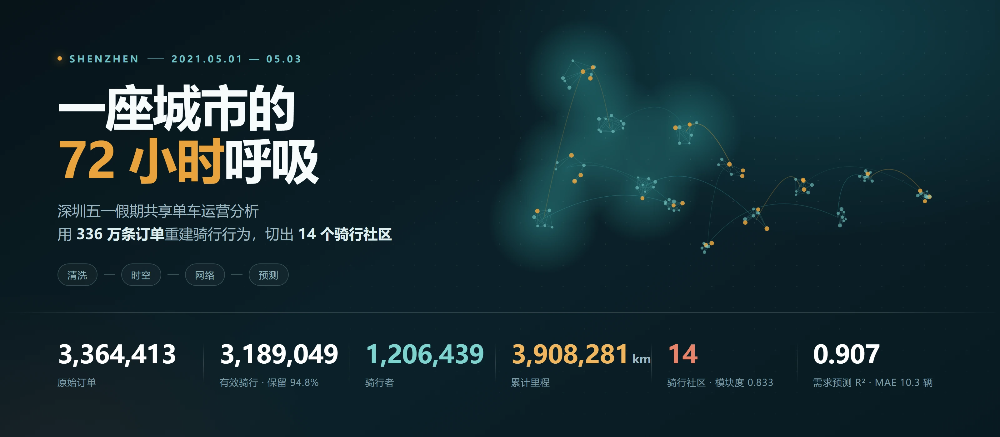
</div>

<p align="center">
  <a href="https://www.python.org/"></a>
  <a href="https://jupyter.org/"></a>
  <a href="https://pandas.pydata.org/"></a>
  <a href="https://scikit-learn.org/"></a>
  <a href="https://networkx.org/"></a>
  
</p>

<p align="center">
  <b>用 336 万条订单，重建一座城市在 72 小时里的呼吸。</b><br>
  <sub>清洗 → 时空分析 → OD 网络 → 社区发现 → 潮汐失衡 → 需求预测</sub>
</p>

<p align="center">
  <a href="深圳五一共享单车_骑行时空分析.ipynb"><b>主报告 ›</b></a> &nbsp;·&nbsp;
  <a href="shenzhen_bike_heatmap3.html">交互式热力图 ›</a> &nbsp;·&nbsp;
  <a href="https://opendata.sz.gov.cn/">数据来源：深圳市政府数据开放平台</a>
</p>

---

## 六个发现

| # | 发现 | 关键数字 |
|---|------|----------|
| 1 | 同一个假期，三天是三套剧本 | 5/1 共 127.9 万次，18 点单小时 9.65 万次；5/3 傍晚反弹至 8.9 万次/小时 |
| 2 | 5/2 16:10 前后，全市骑行在 80 分钟内下降 60% | 35 个片区中 33 个同步下跌；5/2 订单量比 5/1 少 32.7% |
| 3 | 骑行是“最后两公里”的生意 | 中位距离 900 m、中位时长 9.6 分钟，86% 的骑行不超过 2 km |
| 4 | 城市由 14 个强内聚的骑行社区组成 | 网络模块度 0.833，95.96% 的骑行不跨社区 |
| 5 | 早高峰向就业中心汇聚，晚高峰反向流出 | 2 公里块单小时最大净流入 +456 辆/天，最大净流出 −563 辆/天 |
| 6 | 1 小时前瞻需求可以预测得相当准 | 网格级 MAE 10.3 辆，较历史均值基线下降 24%，R² = 0.91 |

---

## 图谱

下面 10 张图全部由主报告 notebook 直接产出，共用一套配色：青绿为主色，橙色标记异常与对照。

### 三天，三套剧本

<p align="center">
  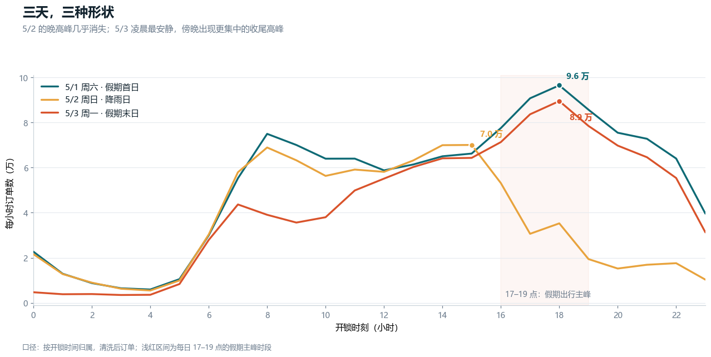
</p>

<p align="center"><sub>
5/1 是标准假日双峰，18 点见顶；5/2 的晚高峰几乎消失；5/3 凌晨最安静，傍晚出现更集中的收尾高峰。
</sub></p>

### 5 月 2 日：一场午后急刹

<p align="center">
  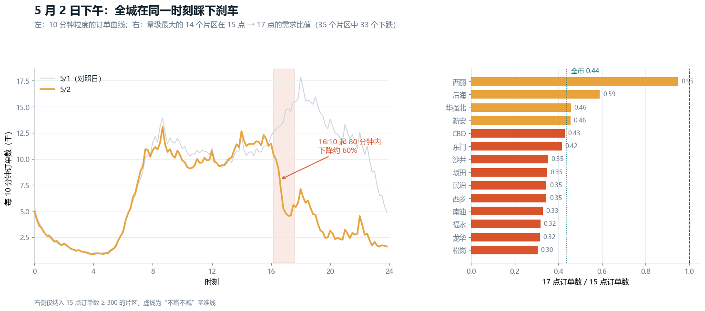
</p>

<p align="center"><sub>
左：10 分钟粒度的订单曲线，16:10 起 80 分钟内下降约 60%，此后全天未能恢复。
右：17 点 / 15 点需求比值，35 个片区里 33 个下跌，跌幅最大的西丽只剩 0.15。
</sub></p>

### 热力骨架与骑行社区

<table>
  <tr>
    <td width="50%" valign="top">
      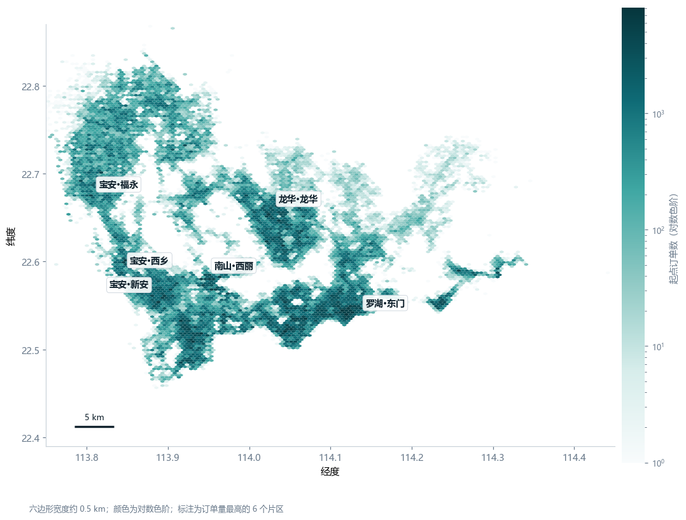
      <br><sub><b>318.9 万个起点</b><br>0.5 km 六边形，对数色阶。西部—中部走廊连成一片，东部只剩几条细线。</sub>
    </td>
    <td width="50%" valign="top">
      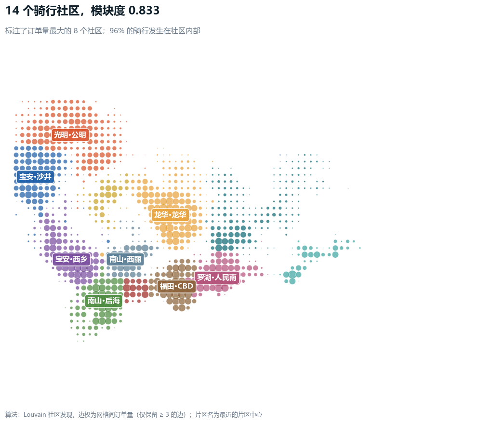
      <br><sub><b>Louvain 切出 14 个社区</b><br>模块度 0.833（社会网络通常 0.3–0.7）。不是行政区的复制品，但和行政区高度相关。</sub>
    </td>
  </tr>
</table>

### 最后两公里与 OD 网络

<table>
  <tr>
    <td width="50%" valign="top">
      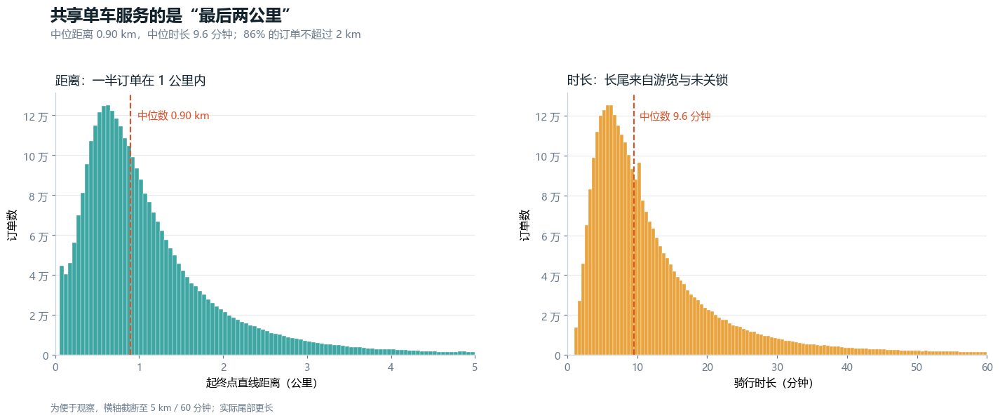
      <br><sub><b>86% 的骑行不超过 2 km</b><br>中位 0.90 km / 9.6 分钟；长尾来自游览与未关锁。</sub>
    </td>
    <td width="50%" valign="top">
      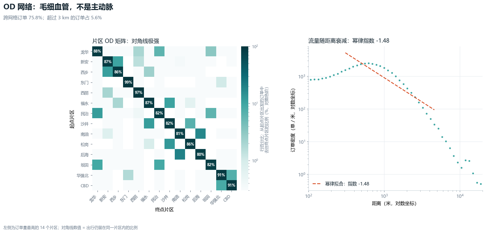
      <br><sub><b>毛细血管，不是主动脉</b><br>跨网格订单占 75.8%，超过 3 km 的仅 5.6%；流量随距离幂律衰减，指数 −1.48。</sub>
    </td>
  </tr>
</table>

### 城市的呼吸：潮汐与失衡

<p align="center">
  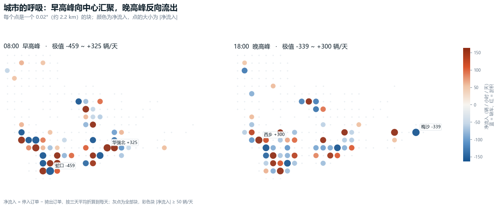
</p>

<p align="center"><sub>
08:00 车流向就业中心汇聚：华强北净流入 325 辆/天，蛇口净流出 459 辆/天。18:00 方向反转，西乡转为净流入，梅沙被抽空。
</sub></p>

### 用户的头部与长尾

<p align="center">
  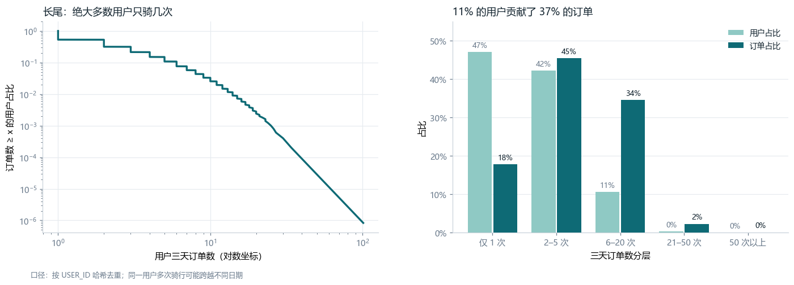
</p>

<p align="center"><sub>
120.6 万骑行者在三天里人均 2.64 单，47% 只骑了一次；11% 的高频用户贡献了 37% 的订单。
</sub></p>

### 一小时前瞻：把节律变成预测

<p align="center">
  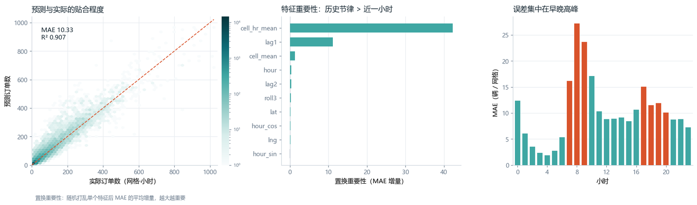
</p>

<p align="center"><sub>
测试集为 5/3 全天的 27,456 个网格-小时。平均绝对误差 10.3 辆，误差集中在早高峰 7–9 点与晚高峰 17–18 点——恰恰是最需要提前调度的时候。
</sub></p>

---

## 分析链路

<p align="center">
  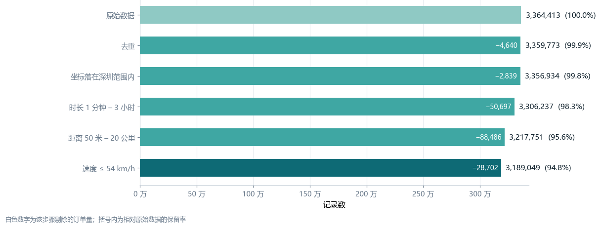
</p>

<p align="center"><sub>五道清洗规则只剔除物理上不可能或无法用于时空分析的记录，保留 94.8%。</sub></p>

<p align="center">
  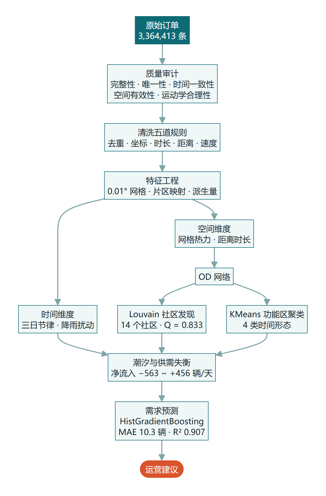
</p>

<p align="center"><sub>链路图由 Mermaid 渲染后导出（源文件 <code>assets/src/pipeline.mmd</code>，可重新渲染），静态图片在任何网络环境下都能正常显示。</sub></p>

清洗后保留 **3,189,049** 条有效骑行，唯一用户 **1,206,439**，累计里程 **3,908,281 km**。

---

## 技术栈

| 环节 | 工具 |
|------|------|
| 数据处理 | Python、pandas、NumPy |
| 空间计算 | Haversine、0.01° 地理网格、Folium |
| 图分析 | NetworkX（Louvain 社区发现） |
| 机器学习 | scikit-learn（KMeans、HistGradientBoosting） |
| 可视化 | Matplotlib、Seaborn |

---

## 项目结构

```
.
├── 深圳五一共享单车_骑行时空分析.ipynb   # 主报告：完整分析流程与全部图表
├── 01_data_cleaning.ipynb               # 早期清洗草稿（已被主报告第 3–4 节取代）
├── shenzhen_bike_heatmap3.html          # Folium 交互式热力图
├── shenzhen_row_data.py                 # 开放数据平台抓取脚本（分页拉取订单）
├── price.py / commerce_values.py        # 收入估算脚本（假设写在注释里）
├── 收入分析_PowerBI数据.xlsx             # Power BI 报表数据源
├── assets/
│   ├── hero.webp                        # README 头图
│   ├── figures/                         # 主报告导出的 10 张图
│   ├── supplement/                      # 早期探索与 Power BI 报表截图
│   └── src/hero.html                    # 头图的 HTML 源码，可重渲染
└── README.md
```

---

## 运行

```bash
pip install pandas numpy matplotlib seaborn networkx scikit-learn folium geopy jupyter
jupyter notebook
```

打开 `深圳五一共享单车_骑行时空分析.ipynb`，从上到下顺序执行。8 GB 内存的普通笔记本完整运行约需 2–4 分钟，峰值内存约 2.5 GB。

---

## 数据说明

原始数据 `bike_orders_20210501_20210503.csv`（432 MB，3,364,413 行）**未包含在本仓库中**：超过 GitHub 单文件 100 MB 限制，且属于第三方开放数据。

获取方式：深圳市政府数据开放平台（共享单车订单数据）。下载后放到 notebook 同级目录，或设置环境变量 `BIKE_DATA_PATH` 指向该文件。

| 字段 | 含义 |
|------|------|
| `START_TIME` / `END_TIME` | 开锁 / 关锁时间（秒级） |
| `START_LAT` / `START_LNG` | 起点经纬度（WGS-84） |
| `END_LAT` / `END_LNG` | 终点经纬度（WGS-84） |
| `USER_ID` | 用户标识（脱敏哈希） |
| `COM_ID` | 整列为空，已在加载阶段剔除 |

---

## 局限

1. **距离为直线距离**。用 Haversine 计算起终点大圆距离，系统性小于实际骑行路径 10%–30%。
2. **降雨是推断而非观测**。数据中没有气象字段，“5/2 断崖由降雨导致”是基于“全城同步、快速见底、持续低迷”三条证据的推断，需要气象数据才能坐实。
3. **只有三天，没有工作日对照**。结论只适用于“五一假期这三天”，不能直接推广到“假期 vs 工作日”的差异。
4. **缺少车辆 ID**。无法计算车辆周转率，也无法做车辆级调度仿真。
5. **模型只在 5/3 一天上测试**，且该日紧邻降雨日，测试集本身带有特殊性。

---

<details>
<summary><b>附：早期探索与商业分析（Power BI）</b></summary>

<br>

主报告之外，仓库里还保留了一版更早的探索性分析，以及基于同一批订单构建的 Power BI 业务报表。这些图表的视觉风格较早，保留是为了留存分析过程。

<table>
  <tr>
    <td width="50%" valign="top">
      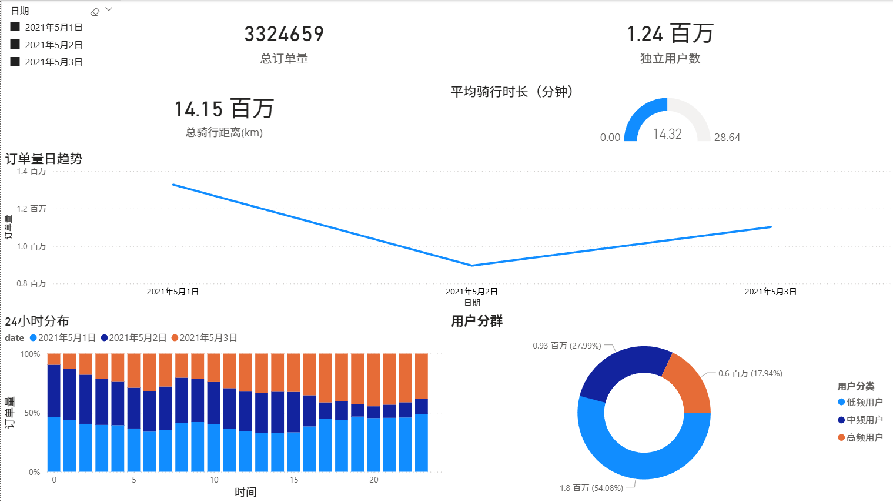
      <br><sub>Power BI：订单量、用户分群与 24 小时分布</sub>
    </td>
    <td width="50%" valign="top">
      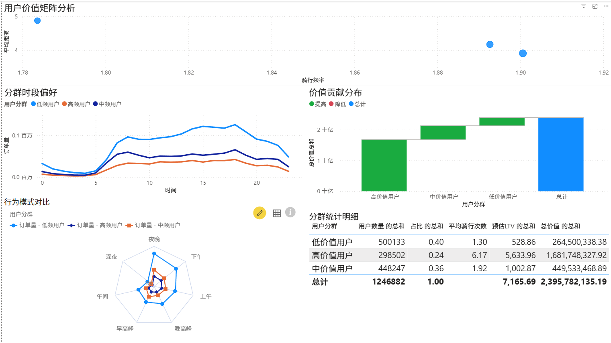
      <br><sub>用户价值矩阵与分组贡献</sub>
    </td>
  </tr>
  <tr>
    <td width="50%" valign="top">
      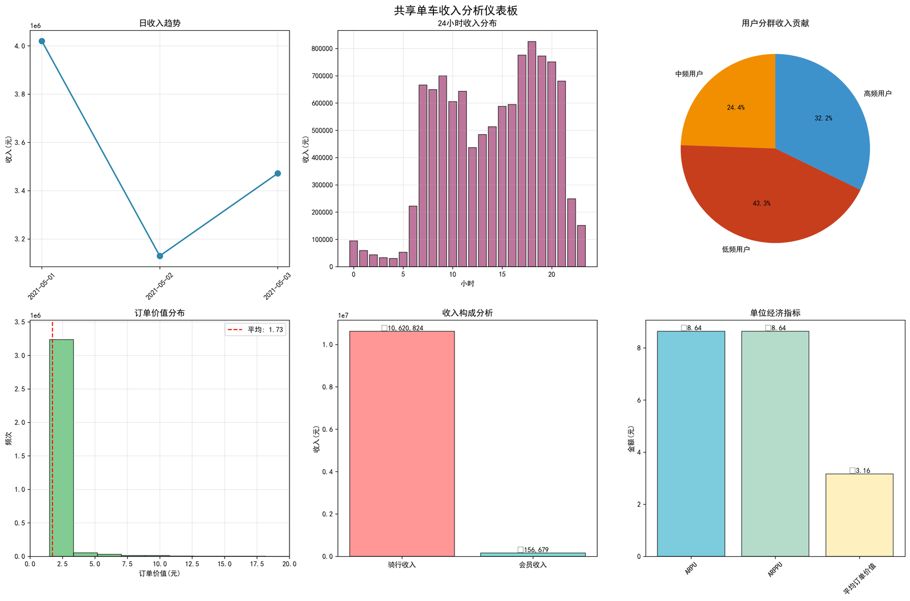
      <br><sub>收入估算看板：客单价、时段收入与用户贡献</sub>
    </td>
    <td width="50%" valign="top">
      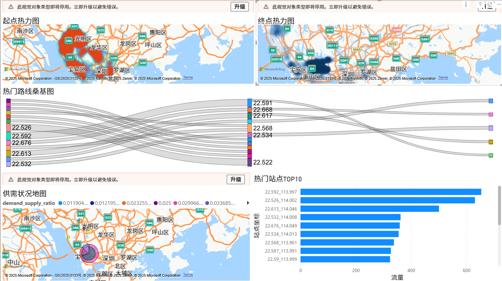
      <br><sub>起终点热力、热门走廊与供需比地图</sub>
    </td>
  </tr>
</table>

</details>

---

## 作者

**贾晨宇（Chenyu Jia）** · 武汉商学院 · 大数据管理与应用

- GitHub：[@JIAChenyu525](https://github.com/JIAChenyu525)

<p align="center"><sub>如果这份分析对你有一点点帮助，欢迎点一个 ⭐</sub></p>
